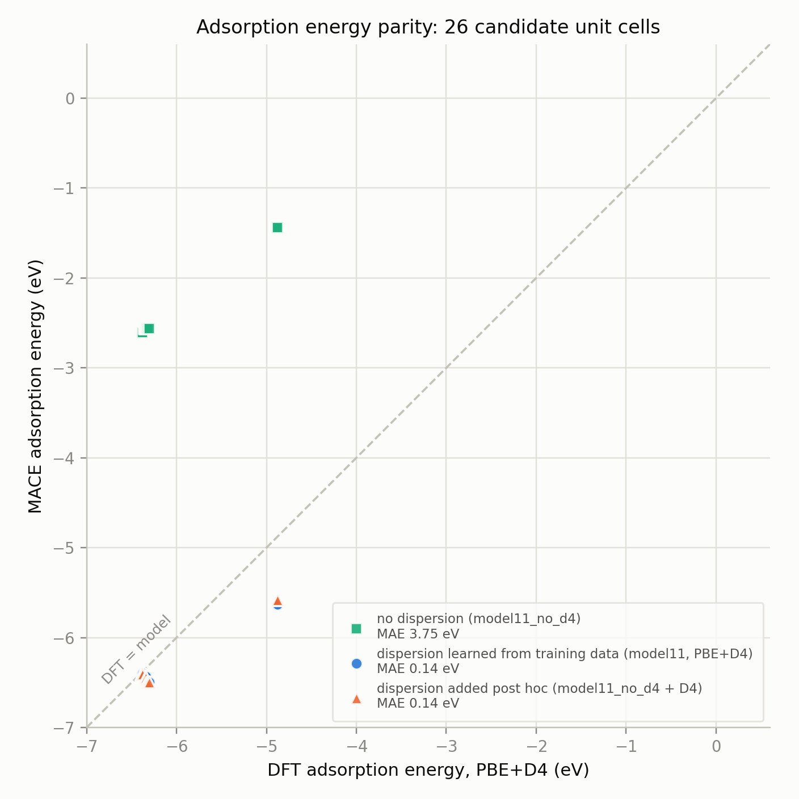
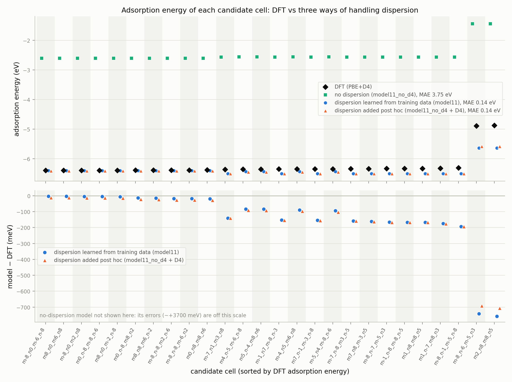

# Adsorption energies with three ways of handling dispersion (model11 family)

Generated automatically 2026-10-20 16:07 by `make_report_m11.py`.



Per-cell view (every cell on its own x position, so no point hides another):



## The three models

All three share the same base (model_01 lineage, MACE, 5 Å cutoff, 2 layers) and the same fine-tuning structures: model11's DFT data for this system (relaxation snapshots of the bound systems and bare substrates of 12 training, 2 validation and 2 test cells, plus the isolated 126-atom molecule). They differ only in how dispersion enters:

- **no dispersion**: model11_no_d4: fine-tuned on PBE-only labels (D4 stripped), nothing added at inference.
- **learned dispersion**: model11: fine-tuned on PBE+D4 labels, so D4 is learned implicitly within the 10 Å receptive field (5 Å cutoff × 2 layers).
- **post-hoc dispersion**: model11_no_d4 + full-range D4 (dftd4, method=PBE, same as the DFT labels) added to every force call, i.e. during the relaxation.

Every model relaxed the same 26 DFT starting structures with the DFT protocol: combined system relaxed with the substrate fixed, bare substrate single point at the same geometry, isolated molecule relaxed. E_ads = E_system − E_substrate − E_molecule. Reference: the DFT PBE+D4 adsorption energies of the same cells.

## Results

| Series | E_ads mean (eV) | MAE vs DFT (eV) | mean signed error (eV) | MAE, cells seen in fine-tuning (12) | MAE, held-out cells (14) | adsorption height vs DFT (Å) |
|---|---|---|---|---|---|---|
| no dispersion | -2.49 | **3.75** | +3.75 | 3.78 | 3.72 | +0.31 |
| learned dispersion | -6.38 | **0.14** | -0.14 | 0.03 | 0.23 | -0.01 |
| post-hoc dispersion | -6.38 | **0.14** | -0.14 | 0.04 | 0.23 | -0.01 |
| DFT (PBE+D4) | -6.24 | — | — | — | — | (height 3.92 Å) |

For comparison, the model_01-based trio (no adsorption data for this molecule in training) gave MAEs of 6.35 / 5.54 / 4.12 eV (no / learned / post-hoc).

## What the dispersion treatment does

- **Ranking by error:** learned dispersion (0.14 eV) < post-hoc dispersion (0.14 eV) < no dispersion (3.75 eV).
- **Both dispersion-handling models are closer to DFT than the dispersion-free one: yes.**
- **Without dispersion** the model binds by -2.49 eV on average against DFT's -6.24 eV, an under-binding of +3.75 eV. In DFT, the D4 share of E_ads is -4.38 eV and the PBE share -1.87 eV, so the dispersion-free gap should be roughly the D4 share. The molecule sits +0.31 Å from the DFT height.
- **Post-hoc D4** splits into a D4 part of -4.39 eV (DFT: -4.38) and a model (PBE) part of -1.99 eV (DFT: -1.87). The remaining error lies mostly in the model's PBE part, not in the dispersion.
- **Learned vs post-hoc:** post-hoc is about as accurate as learned (0.14 vs 0.14 eV). The learned model only sees dispersion within 10 Å; the post-hoc model includes the full-range tail, which for these cells is a near-uniform ~−0.1 eV (earlier tail measurement, eads_vs_R).

## Caveats

- 12 of the 26 cells were in the fine-tuning data; 14 were not. The plot does not distinguish them; the table does. Held-out errors are the fairer measure.
- The two 234-atom cells (m-8_n-6_m-5_n3, m2_n8_m8_n5) are a cell type absent from the fine-tuning data; mean error on them: no dispersion +3.44 eV, learned dispersion -0.75 eV, post-hoc dispersion -0.70 eV. Held-out MAE without them: no dispersion 3.77 eV, learned dispersion 0.15 eV, post-hoc dispersion 0.15 eV.
- The DFT pure-PBE binding (~−2 eV at the PBE+D4 geometry) has not been independently checked (open question); it sets where the no-dispersion points should land.
- The post-hoc series uses D4, the same dispersion as the DFT reference. With D3 it would be compared against a reference with a different dispersion model.

## Run status

- no dispersion: 0 relaxations not converged, 0 fragmented adsorbates.
- learned dispersion: 0 relaxations not converged, 0 fragmented adsorbates.
- post-hoc dispersion: 0 relaxations not converged, 0 fragmented adsorbates.

<details><summary>pipeline log</summary>

```
m01_d4trained: 26/26 done; not converged -; integrity flags -; molecule converged True
m01nod4: 26/26 done; not converged -; integrity flags -; molecule converged True
m01nod4_d3: 26/26 done; not converged -; integrity flags -; molecule converged True
m01nod4_d3_15: 26/26 done; not converged -; integrity flags -; molecule converged True
m01nod4_d4: 26/26 done; not converged -; integrity flags -; molecule converged True
m11nod4: 26/26 done; not converged -; integrity flags -; molecule converged True
m11nod4_d4: 26/26 done; not converged -; integrity flags -; molecule converged True
m11_d4trained: 26/26 done; not converged -; integrity flags -; molecule converged True
wrote /scratch/johnt447/azin/analysis/ads_eng_calc/dispersion_inference/eads_all_variants.csv (234 rows)
m11nod4         MAE 3.750 eV   mean E_ads -2.495 eV
m11_d4trained   MAE 0.138 eV   mean E_ads -6.383 eV
m11nod4_d4      MAE 0.139 eV   mean E_ads -6.384 eV
DFT                             mean E_ads -6.245 eV
saved /scratch/johnt447/azin/analysis/ads_eng_calc/dispersion_inference/eads_parity_s18_style_m11.png
saved /scratch/johnt447/azin/analysis/ads_eng_calc/dispersion_inference/eads_per_cell_m11.png
```
</details>
