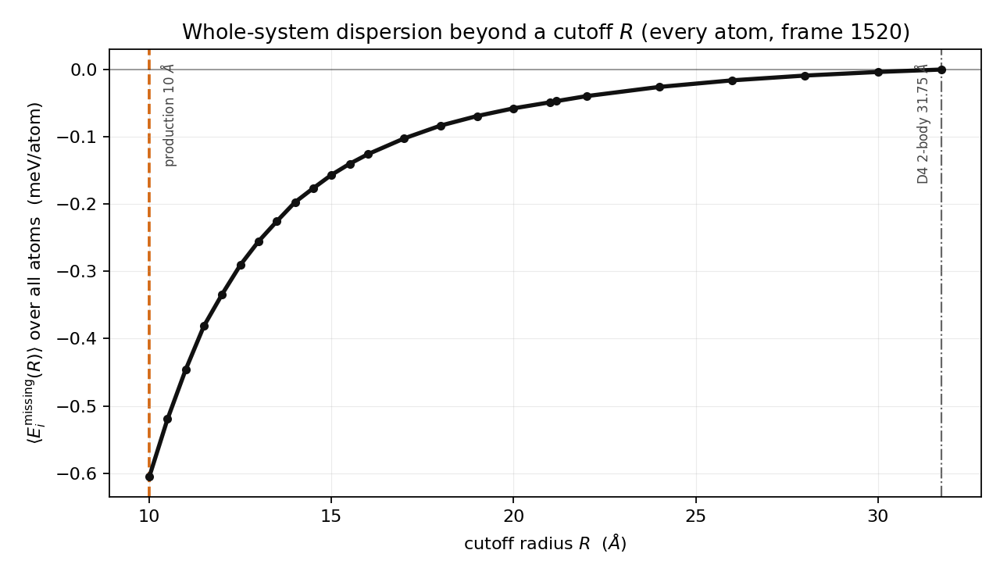
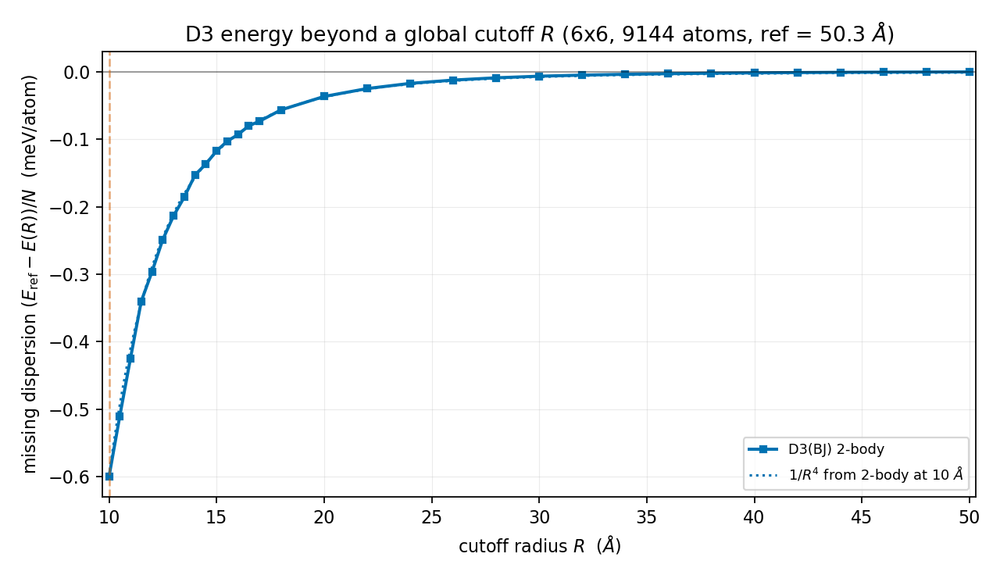
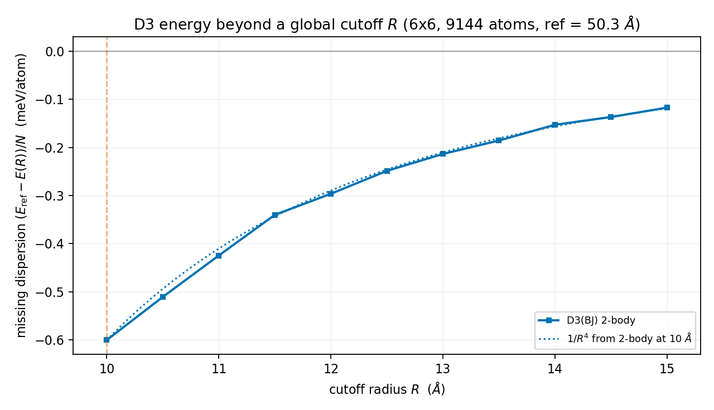
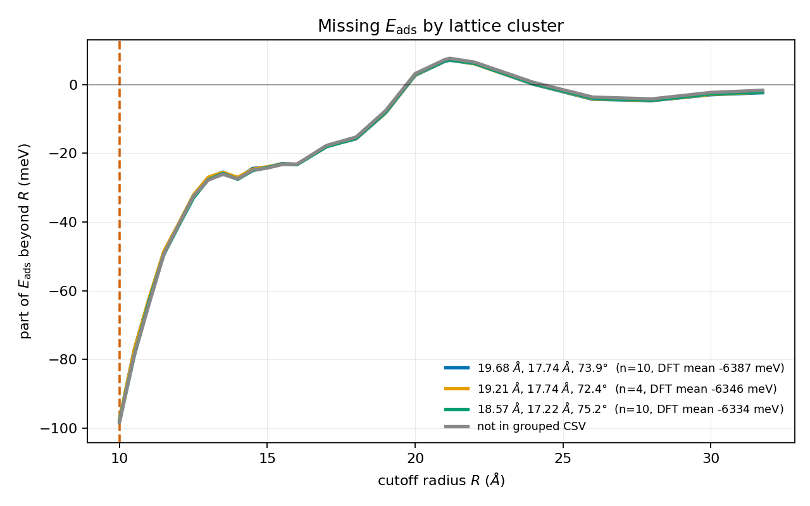
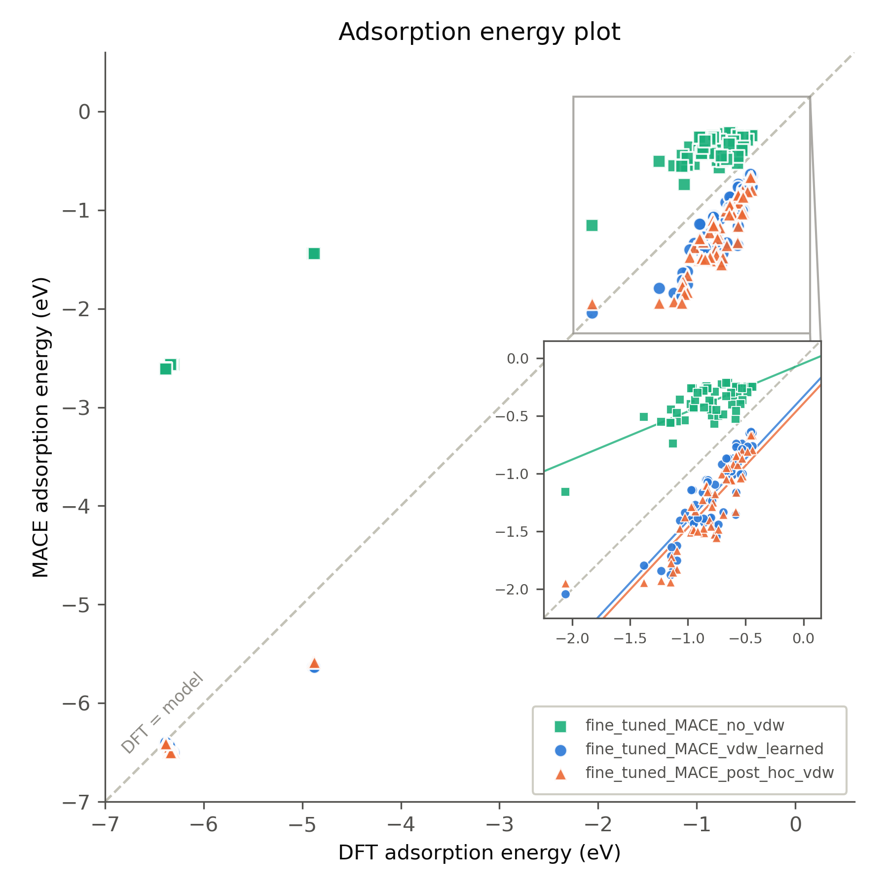
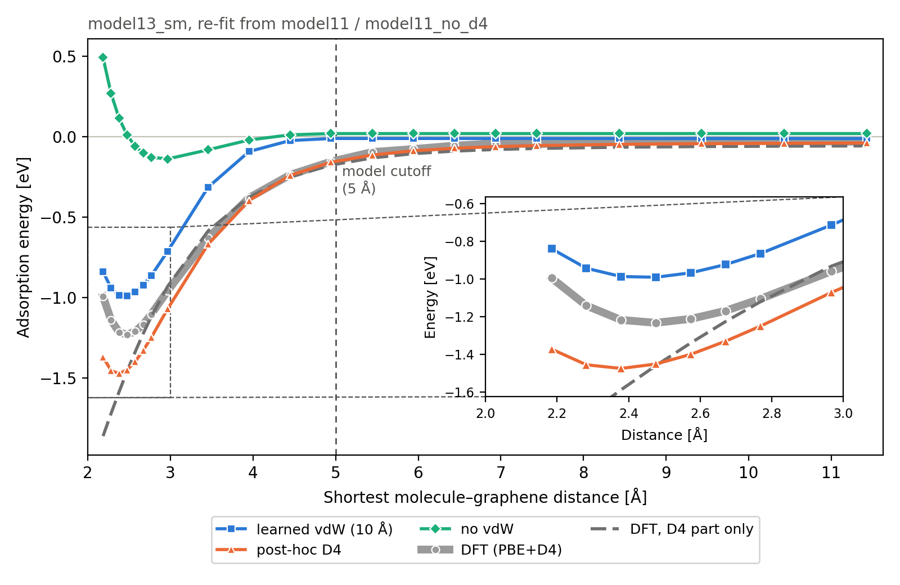

# Does dispersion beyond the MACE receptive field matter for porphyrin on graphene?

*Report on the calculations done for the long-range-dispersion question.*

## 1. The question

Our MACE potentials see 5 Å around each atom and pass messages through two layers, so an atom's energy depends on its surroundings up to a nominal 10 Å. The DFT labels they were trained on are PBE + D4, and D4 dispersion reaches to about 32 Å. The models can therefore only ever have learned the dispersion that lies within 10 Å; whatever D4 contributes from beyond that range is missing from the model.

The question from the meeting was, precisely:

1. **How much dispersion energy lies beyond 10 Å** for this system, and where does it stop growing with the cutoff? The scale given: about 0.1 meV per atom is tiny and can be ignored; about 0.5 meV per atom is unclear and must be checked structurally. The check was to be done with D3 (or D4) alone on the dry slab, over 10-15 Å, without any DFT.
2. **If it is not tiny, does it change the structure prediction?** That is, the adsorption energies of the candidate unit cells and their ranking, which decides the predicted self-assembled lattice. The suggested test: retrain MACE without van der Waals, then redo the adsorption-energy comparison with three models - no vdW, short-range (learned) vdW, and a "complete" model that adds the long-range correction on top of the vdW-free model - relaxing the structures with each, and see whether the three line up. It was explicitly not accepted that the ranking must stay unchanged just because the missing energy looks similar across structures; this had to be checked on relaxed structures.

Everything below answers these two points. The scripts, raw summaries and plots are in this repository (one folder per test, see Appendix).

## 2. Setup

- **System.** The porphyrin C56H62N8 (tetrakis(4-trimethylammoniophenyl)porphyrin, "TMA", modelled as neutral) on single-layer graphene. 26 candidate unit cells from the supercell search, falling into three lattice clusters (L1/angle 19.68 Å/73.9°, 19.21 Å/72.4°, 18.57 Å/75.2°). Two cells are a smaller 234-atom type; the other 24 are 254 atoms.
- **DFT reference.** GPAW, plane waves 500 eV, PBE, k 2×2×1, energy convergence 1e-6 eV, D4 (PBE parameters) added through ASE's SumCalculator; graphene fixed. Adsorption energy E_ads = E(system) − E(graphene) − E(relaxed isolated molecule).
- **Models.** All MACE, r_max 5 Å, 2 interaction layers (10 Å nominal receptive field), same architecture and fine-tuning structures. Three variants that differ only in how dispersion enters:
  - *no vdW*: model11_no_d4, trained on PBE-only labels (D4 removed from every label).
  - *learned vdW (10 Å)*: model11, trained on PBE+D4 labels; dispersion is learned implicitly within the receptive field.
  - *post-hoc vdW*: model11_no_d4 with full-range D4 (dftd4, same parameters as the DFT labels) added to every energy and force call, including during the relaxations. This is the "complete" long-range model.
- **"Missing dispersion beyond R".** For a cutoff R, the D4 (or D3) energy of the whole system computed with pairs only up to R, minus the full-range value; reported per atom. A model with receptive field R can at best have learned the part within R.

## 3. Part 1 - How much dispersion lies beyond 10 Å?

### Figure 1 - D4 beyond a cutoff, full wet system

**What it measures.** For the production system (graphene + porphyrin + water, 2087 atoms, MD frame 1520) the D4 energy per atom that lies beyond a cutoff R, for R from 10 Å to D4's own two-body limit at 31.75 Å. D4 is the dispersion the models were trained with, so this is directly the part a 10 Å model cannot have learned. Computed per atom with the exact pairwise decomposition (each atom's D4 energy with and without neighbours beyond R), averaged over all atoms.

*Figure 1. Dispersion (D4) energy per atom beyond a cutoff R for the wet porphyrin/graphene slab (frame 1520). Vertical lines: the model's 10 Å receptive field and the D4 two-body cutoff (31.75 Å).*

**Analysis.** At the model's 10 Å the missing D4 energy is −0.60 meV/atom (−0.58 for frame 200; the frame-to-frame variation is 0.02 meV). It decays smoothly: extending the range to 12, 14, 16 and 20 Å would recover 45, 67, 79 and 90 % of it, and the curve reaches zero only at the D4 limit. So the tail is real but small, and most of it sits between 10 and 20 Å. On the supervisor's scale this is the "about half a meV per atom" case, which must be checked structurally - it cannot be dismissed from this plot alone. (A large part of the mean tail is a constant per-element offset that a fitted model absorbs into its atomic reference energies; what can hurt the model is the part that varies between configurations, see Part 2.)

### Figure 2 - D3 beyond a cutoff, dry 6×6 slab (the check requested in the meeting)

**What it measures.** The same quantity, but with D3(BJ) instead of D4 and on a dry slab without water: frame 1520 with the water removed, repeated 6×6 laterally (graphene + 36 porphyrins, 9144 atoms, 118 × 106 Å cell), from 10 to 50 Å, using the stand-alone `dftd3` program with a global pair cutoff (reference: the `dftd3` default of 50.3 Å). This is exactly the test proposed in the meeting: an analytical dispersion energy versus cutoff, no DFT involved. The cell is 51 Å in half-width, so over the whole range no atom sees its own periodic image and every point is a clean measurement. The curve is the two-body D3 term.

*Figure 2. Dispersion (D3, two-body) energy per atom beyond a cutoff R for the dry 6×6 porphyrin/graphene slab, with a 1/R⁴ guide from the 10 Å value. Dashed line: the model's 10 Å receptive field.*

*Figure 2b. The same curve zoomed on 10-15 Å, the range asked for in the meeting.*

**Analysis.** D3 gives the same picture as D4: −0.60 meV/atom missing at 10 Å, −0.30 at 12 Å, −0.12 at 15 Å, −0.04 at 20 Å and −0.006 at 30 Å, i.e. extending the range to 15 and 20 Å would recover 80 and 94 % of it. The decay follows 1/R⁴, as expected for a molecule layer over a 2D sheet (log-log slope −4.0 over 10-20 Å), so the curve is essentially flat by 15-20 Å. The D3 and D4 numbers at 10 Å agree to 1 %, and removing the water changes nothing, so the tail is a property of the dry porphyrin/graphene layer itself.

## 4. Part 2 - Does the missing tail differ between structures?

The structure prediction depends on *differences* of adsorption energies between the candidate cells, not on their absolute values. A missing tail that is the same for every cell shifts all of them equally and cannot change which one is most stable.

### Figure 3 - Part of E_ads beyond R, by lattice cluster

**What it measures.** For each of the 26 DFT-relaxed candidate cells, the D4 contribution to the adsorption energy that lies beyond a cutoff R: tail(system) − tail(graphene) − tail(isolated molecule), for R from 10 to 31.75 Å. Shown as the mean per lattice cluster, so the curves can be compared with the DFT energy gaps between clusters (12 and 41 meV).

*Figure 3. The part of the adsorption energy that a model with cutoff R misses, averaged over the cells of each lattice cluster (DFT-relaxed geometries, D4).*

**How each point is calculated.** One point = one lattice cluster at one cutoff R:

1. **Take one cell's DFT-relaxed structure**, and treat three things separately: the full system (molecule on graphene), the graphene alone, and the molecule alone.
2. **For each atom, compute its D4 dispersion energy twice:** in the full periodic structure (what the DFT labels contain), and in a sphere ("ball") of radius R cut out around that atom, so it only feels neighbours within R (what a model with cutoff R can see). The difference is what that atom misses beyond R.
3. **Add this up over all atoms** of each of the three parts, giving the missing energy of the system, of the graphene and of the molecule.
4. **Combine them like an adsorption energy:** missing E_ads = system − graphene − molecule. At R = 10 Å this is about −98 meV for every cell.
5. **Average over the cells in the cluster** (10, 4 or 10 cells). That average is the point plotted at this R.

This is repeated for R = 10, 10.5, … up to 31.75 Å, where D4 stops; at 31.75 Å the missing part should be about zero, which the script checks. Only D4 is used: no DFT is re-run and no MACE model is involved.

**Analysis.** At 10 Å every cell misses about −97.7 meV, and the clusters differ from each other by less than 0.5 meV. That is far below the 12 and 41 meV DFT gaps, so the ranking can't change. Individual cells differ by at most 1.7 meV at 10 Å (2.5 meV at any cutoff), and none of the 325 cell pairs changes order at 10 Å; the only swap at any cutoff is a pair 0.36 meV apart in DFT.

| Cell | Missing E_ads at 10 Å |
|---|---|
| m-8_n-1_m-5_n-8 (misses the most) | −98.93 meV |
| m0_n8_m8_n6 (misses the least) | −97.23 meV |
| Difference | **1.7 meV** |

That matters because two cells can only swap places if the difference in what they miss is bigger than their DFT energy difference. The most any two cells can differ in "what their E_ads is missing" is 1.7 meV, so only cells closer than that in DFT could ever swap. At 10 Å no pair swaps.

As agreed in the meeting, this still had to be confirmed on structures *relaxed* with the models, which is Part 3.

## 5. Part 3 - The three-model comparison on relaxed structures

### Figure 4 - Adsorption energies, three models against DFT

**What it measures.** Each of the three models relaxed all 26 candidate cells from the DFT starting structures with the DFT protocol (graphene fixed, bare graphene single point, isolated molecule relaxed), and its adsorption energy is plotted against the DFT value. The same was done for 57 small C/H/N molecules on graphene from the foundation-model data (inset), as an independent set of adsorbates. The diagonal is perfect agreement; the legend gives the mean absolute error (MAE).

*Figure 4. Adsorption energies from the three models versus DFT (PBE+D4): 26 porphyrin candidate cells (left cluster near −6.4 eV) and 57 small molecules on graphene (inset). no vdW = model11_no_d4; learned vdW = model11; post-hoc vdW = model11_no_d4 + full-range D4.*

**Analysis.**

- *Without dispersion* the porphyrin binds by −2.5 eV on average against DFT's −6.2 eV (MAE 3.75 eV) and sits 0.31 Å too high. The gap is almost exactly the D4 share of the DFT adsorption energy (−4.4 eV): dispersion is most of the binding here.
- *Learned and post-hoc dispersion give the same result.* Both have MAE 0.14 eV on the 26 cells (0.03-0.04 eV on the 12 cells seen in fine-tuning, 0.23 eV on the 14 held-out ones), the same relaxed adsorption height (0.01 Å from DFT), and their per-cell adsorption energies differ by −0.9 ± 15 meV. The post-hoc model's D4 part is −4.39 eV against −4.38 eV in DFT; its remaining error is in the PBE part of the model, not in the dispersion. In other words, adding the full 32 Å dispersion on top of the vdW-free model lands exactly where the 10 Å model already was.
- *Small molecules (inset)* show the same: MAE 0.39 eV (learned) vs 0.46 eV (post-hoc), both with slope 1.07 against DFT; the dispersion-free model is flat (slope 0.42). The models overbind the small molecules by about 0.5 eV in both dispersion variants - a near-surface model error shared by both, unrelated to range.

### Figure 5 - Adsorption-energy profile of a small molecule, after the small-molecule re-fit

**What it measures.** The test molecule is m37 (C17H19N3), held out of fit. It is lifted rigidly off the surface in 21 steps, and at each height the adsorption energy is computed as a single point, with the molecule relaxed alone (same method) as reference. This is done with DFT (PBE+D4) and the three model variants: learned vdW (d4_from_m11), post-hoc D4 (no_d4_from_m11 + full D4) and no vdW (no_d4_from_m11). The dashed line is the D4 part of the DFT curve.

*Figure 5. Adsorption energy of m37 versus its shortest distance to graphene for DFT and the three model13_sm (from model11) variants. Inset: the well. Vertical line: the 5 Å model cutoff.*

**Analysis.**

- *In the well* (2.48 Å) DFT gives −1.23 eV. The learned model gives −0.99 eV (0.24 eV too weak) and the post-hoc model −1.45 eV (0.22 eV too strong). Before the re-fit, model11 gave −1.79 and −1.88 eV (0.56 and 0.64 eV too strong), so the re-fit cut the well error by about two thirds, but neither variant matches DFT.

### Ranking of the lattice clusters

Whether the long-range term changes the *ordering* was checked:

| Model | Cluster order (most stable first) |
|---|---|
| DFT (PBE+D4) | 19.68/73.9° (−6.387) < 19.21/72.4° (−6.346) < 18.57/75.2° (−6.334) |
| model_01, learned vdW | 19.68 < 19.21 < 18.57 - **same as DFT** |
| model_01_no_d4 + post-hoc D4 | 19.68 < 19.21 < 18.57 - **same as DFT** |

## 6. Answer

- 
- 
- 
- 

## Appendix - where the results live

| Part | Repository folder | Original location |
|---|---|---|
| Fig. 1 | `01_tail_vs_cutoff/` (`measure_d4_tail_vs_R_all_atoms.py`, `summary.txt`) | `analysis/d4_strip_test/all_atoms_vs_R/` |
| Fig. 2 | `01_tail_vs_cutoff/dry_slab_d3/6x6_no_water/` (`plot_6x6_two_body.py`, `d3_vs_R_6x6_two_body.csv`; energies from `measure_d3_vs_R.py`, job 1877883) | `analysis/d4_strip_test/d3_vs_R/6x6_no_water/` |
| Fig. 3 | `02_eads_ranking_vs_cutoff/` (`measure_eads_tail_vs_R.py`, `plot_eads_tail_by_cluster.py`, `summary.txt`) | `analysis/d4_strip_test/eads_vs_R/` |
| Fig. 4, ranking | `03_porphyrin_eads_learned_vs_posthoc/` (`relax_with_dispersion.py`, `report_m11/`, `paper_figures/`) | `analysis/ads_eng_calc/dispersion_inference/`, `paper_figures/` |
| Fig. 5 | `08_height_scan_m37/` (plot + E_int table, model13_sm from model11) | `analysis/ads_eng_calc/height_scan_m37/results/04_model13_sm_from_m11/` (all model families: `results/INDEX.md`) |
| Small molecules | `04_small_molecules/` | `analysis/ads_eng_calc/small_molecules/` |
| Long-range screen | `05_longrange_screen/` | `analysis/ads_eng_calc/longrange_candidates/` |
| Multilayers | `06_multilayer_graphene/` | `analysis/ads_eng_calc/multilayer_test/` |

Models: `SPICE_MACE/model11_adsorption_dft_activelearning/model11_stagetwo.model` (learned vdW), `SPICE_MACE/model11_no_d4/model11_no_d4_stagetwo.model` (no vdW; + dftd4 for post-hoc), foundation lineage `SPICE_MACE/model_01/`. Dispersion at inference: dftd4 3.7 (D4, PBE parameters) via ASE SumCalculator; D3(BJ) via the `dftd3` binary (module gpaw/25.7.0) for the cutoff scan and torch-dftd for the screen.
